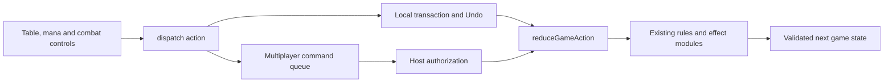

# Gameplay action architecture

Local hotseat and multiplayer use the same gameplay commands and reducer in `game-actions.mjs`. A control describes the requested action once. It does not carry both a local mutation callback and a separate packet implementation.

## Responsibilities

| Location | Responsibility |
| --- | --- |
| `app.mjs`, `mana-ui.mjs`, `combat-ui.mjs` | Read state, collect choices, dispatch typed actions and render results |
| `game-actions.mjs` | Apply a command to a cloned canonical game; delegate costs, rules, effects, priority and phases; validate the result |
| `multiplayer/actions.mjs` | Authorize the assigned seat, restrict manual controls, normalize concealed-library draws, and produce public log summaries |
| `multiplayer/server.mjs` | Serialize commands, check revisions, checkpoint, acknowledge and broadcast authorized views |
| Existing engine/effect modules | Implement actual rules, shared Oracle instruction families and state transitions |

The gameplay reducer is browser-safe and has no Electron, socket or Node dependencies. It is a trusted application API, not an authorization boundary. Multiplayer must enter through its authorization adapter, which allows only explicitly listed commands. Adding a new gameplay command does not automatically expose it to network clients.

## Commands and UI effects

Controls call `dispatch({type, ...choices}, {message, after})`. For example, a mana source supplies its instance ID, ability key and chosen output. The same values go to the local reducer or the host. Modal fields are read before dispatch; handlers do not retain mutable DOM or card references.

`after` is optional presentation work, such as closing a dialog or rebuilding the mana-pool editor after success. It is never serialized. Stack visibility, local seat changes and reset bookkeeping run in the application's completion path. Failed commands do not run these completion effects.

The reducer copies the JSON state and command containers while retaining immutable string values, so cached image bytes are not serialized again for every action. Costs or multi-step mutations that fail leave the original table and caller's command untouched. The local transaction retains Undo snapshots and restores cached art on failure; the server commits only after its durable checkpoint succeeds. Shared clients render the host's accepted state and do not independently simulate rules.

## Intentional local/shared differences

Local play retains manual setup and correction controls: switching seats, moving cards between zones, placing cards directly on the stack/battlefield and resolving directly. Shared games require each player to act from their assigned seat, pay casting costs and pass priority. These are authorization and control differences; the underlying gameplay operations use the same implementation.

Fresh/practice tables, player-count changes, loading local sessions and artwork alignment remain local operations. Camera and dock preferences remain presentation state. Deferred entry prompts use the permanent?s entry identity rather than an object reference, and artwork caches retain image-version metadata across state replacement. Shared Undo, automatic-turn settings and seat release remain room operations, because they concern server history or connections.

Existing saved-session and packet formats remain compatible. No new Oracle coverage is implied by this refactor; the deck checklist remains the source of implementation status.

## Extending behavior

1. Add the reusable rules/effect behavior to the appropriate existing module.
2. Add or extend one command in `game-actions.mjs`; keep DOM and transport code out of it.
3. Dispatch that command from controls. Put presentation changes in `after` or the common completion path.
4. If shared clients may invoke it, explicitly authorize it in `multiplayer/actions.mjs`, including seat, card-zone and pending-choice ownership checks.
5. Verify the gameplay outcome, rollback on failure, and relevant local/shared UI paths. Avoid a second implementation in a renderer callback or socket handler.

`tests/game-actions.test.mjs` covers local manual controls, hotseat ownership, shared permissions, reaction timing, rollback, imports/artwork, token locations and player-stat preservation. The complete test commands also cover all existing Oracle, transport and Electron workflows.
